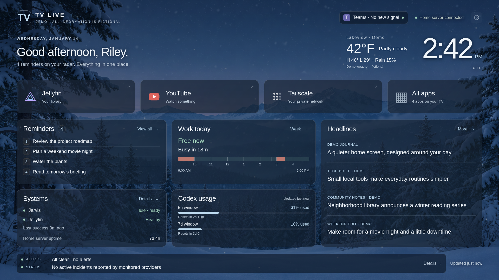
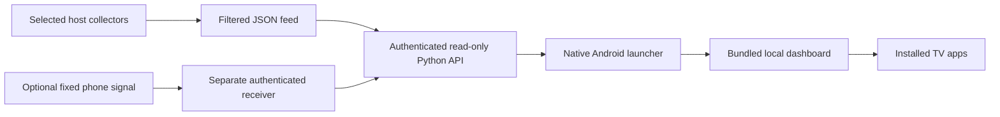

# TV Live Dashboard

A custom, bloatware-free home screen for Android TV: your apps, reminders,
availability, weather, headlines, and system status in one remote-friendly view.

The project delivers a custom OS-style TV experience through a native Android
launcher and a local dashboard. It runs on the TV's existing Android firmware.
The cleanup tools reversibly disable reviewed vendor apps and extras while
preserving their APKs, data, protected functionality and recovery options.

## Demo



**Everything shown above is fictional:** the person, reminders, weather, work
intervals, headlines, usage, and system state. This is a render of the actual
project UI, with no connection to a real TV, calendar, account or home server.

```sh
python3 demo/serve.py
```

Open `http://127.0.0.1:8080/demo/`. Arrow keys, Enter and Escape work as a remote.
App buttons simulate a native action; they do not launch local programs. The
loopback server serves only demo/web assets and rejects private state, build
outputs, repository internals, scripts and directory listings.

## Features

- **Clean home screen:** no vendor recommendation carousel or advertising feed.
- **Apps:** Jellyfin, YouTube, Tailscale and an installed-app picker.
- **Widgets:** reminders, availability, weather, headlines and system status.
- **Alerts:** stale data, service problems, storage and usage thresholds.
- **Service news:** selected official status feeds with incident details and timestamps.
- **Phone signal:** an optional Teams badge carrying fixed events only.
- **Themes:** local winter artwork, snowfall, Midnight and offline solar lighting.
- **Offline operation:** app shortcuts and clock remain usable; saved data is labeled.
- **Remote navigation:** spatial focus, overlays, scrolling and Home recovery.
- **Cleanup:** recorded package-disable plans and original-state restoration.

## Architecture



The interface is bundled in the APK. A narrow native bridge launches known apps
and selected Settings screens. Host collectors publish filtered display data;
calendar collection exports anonymous intervals. The separate phone receiver
accepts a fixed flag instead of message text or Teams account access.

See [operations](docs/operations.md), [demo details](docs/demo.md), and
[snapshot provenance](docs/publication.md).

| Directory | Purpose |
| --- | --- |
| `android/` | Native launcher, local asset handling and Android bridge. |
| `web/` | Dashboard UI, themes, solar lighting and snow animation. |
| `server/` | Read-only API, selected public feeds and phone signal receiver. |
| `scripts/` | Collectors, Android build/deploy helpers, cleanup and recovery. |
| `demo/` | Fictional fixtures, restricted server and browser/screenshot checks. |
| `tests/` | Authorization, filtering, outage, phone-signal and demo-boundary tests. |

## Build the Android app

The Linux build uses Python 3, Docker, a pinned Java 17 builder and Android SDK
tools. Google SDK archives are checked against repository metadata on download.
An existing local cache can be reused. Compilation/signing runs without network.

```sh
python3 scripts/init_example_config.py
bash scripts/build_apk.sh
```

Output: `build/tv-live-dashboard.apk`, package `dev.tvlivedashboard`.
Initialization creates fresh local example credentials/signing material under
ignored `state/private/`; it does not use the existing deployment's keys. The
example endpoint is a documentation address for build verification. Live use
requires configuring the trusted native endpoint, network-security resource,
API/source allowlists and selected TV target.

Device scripts are deployment references with example addresses and paths. The
cleanup plan was developed for one reviewed Hisense board. Its checks protect
launcher recovery, networking, hardware/input, updates, casting and live TV;
package choices still require review on the actual target model.

## Validate

The backend and demo-server regression suite uses Python's standard library:

```sh
python3 -m unittest discover -s tests -q
```

Regenerate the screenshot and check the browser UI:

```sh
python3 -m venv .venv-demo
source .venv-demo/bin/activate
python -m pip install -r requirements-demo.txt
python -m playwright install chromium
python demo/capture.py
```

An installed browser can be selected with `--chromium /path/to/chromium`.
The check covers widgets, layout, week/reminder overlays, remote navigation,
bridge actions, offline cache and recovery. Non-local page requests are blocked
and treated as failures.

`tests/tv_smoke.py` and `tests/tv_integration.py` are separate hardware checks.
They operate on a configured TV and are excluded from normal test discovery and
this publication validation.

## Scope and licensing

This private repository is a one-time sanitized portfolio snapshot. The original
TV installation remains separate. Build state, keys, credentials, real display
data, hardware captures and deployment history are excluded. No automatic
synchronization with the working project is configured.

SunCalc uses its BSD license; the snow motion incorporates MIT-licensed JavaScript
Snow. Original notices are retained in `web/vendor/`. The winter wallpaper was
generated for the project. No open-source license has been selected for the
original code in this private snapshot.
